# 🛒 Classificador de Sentimentos em Reviews de E-commerce

> **Projeto de Machine Learning & Processamento de Linguagem Natural (NLP)** desenvolvido para automatizar a leitura e classificação de avaliações de clientes de um e-commerce em tempo real.


---

## 📌 Sumário
- [Visão Geral e Problema de Negócio](#-visão-geral-e-problema-de-negócio)
- [Fluxo da Solução (Pipeline)](#-fluxo-da-solução-pipeline)
- [Tecnologias Utilizadas](#-tecnologias-utilizadas)
- [Estrutura do Repositório](#-estrutura-do-repositório)
- [Como Configurar e Executar](#-como-configurar-e-executar)
- [Como Usar o Modelo Treinado (Deploy)](#-como-usar-o-modelo-treinado-deploy)
- [Métricas e Avaliação do Modelo](#-métricas-e-avaliação-do-modelo)
- [Autor e Créditos](#-autor-e-créditos)

---

## 🎯 Visão Geral e Problema de Negócio

Empresas de e-commerce recebem diariamente milhares de comentários sobre produtos e atendimento. Analisar esse volume de forma manual é lento, caro e inviável conforme a loja cresce.

### O Desafio
Criar um modelo preditivo capaz de ler comentários de clientes em português e classificá-los automaticamente como:
* **Positivo (`1`)**: Elogios, satisfação com entrega, qualidade do produto.
* **Negativo (`0`)**: Críticas, defeitos, atrasos ou problemas de suporte.

### Benefícios Práticos
* ⚡ **Triagem Imediata para o Suporte:** Clientes que deixam reviews negativos são priorizados instantaneamente pela equipe de atendimento para reverter cancelamentos.
* 📈 **Inteligência de Mercado:** As equipes de produto e marketing identificam gargalos de catálogo e pontos fortes sem precisar ler linha por linha manualmente.
* 💰 **Redução de Custos:** Automatiza a classificação de milhares de mensagens com custo computacional mínimo.

---

## 🔄 Fluxo da Solução (Pipeline)

O projeto foi construído seguindo as melhores práticas da Ciência de Dados e Engenharia de Machine Learning:

```mermaid
flowchart LR
    A["📄 Dataset Bruto (CSV)"] --> B["🔎 Análise Exploratória (EDA)"]
    B --> C["🧹 Limpeza de Texto (Regex & NFKD)"]
    C --> D["🔢 Engenharia de Atributos (0 e 1)"]
    D --> E["🎯 Divisão Estratificada (Treino / Teste)"]
    E --> F["⚙️ Pipeline Scikit-Learn\n(TF-IDF + Scaler + Regressão Logística)"]
    F --> G["🎛️ Otimização (GridSearchCV com 5 Folds)"]
    G --> H["📊 Avaliação (Matriz de Confusão & Relatório)"]
    H --> I["💾 Serialização em Disco (.joblib)"]
    I --> J["🚀 Deploy & Inferência em Produção"]
```



### Detalhamento das Etapas:
1. **Importação e EDA:** Inspeção estrutural da base, contagem de dados faltantes e visualização gráfica do balanceamento das classes.
2. **Higienização Textual:**
   - Conversão de caracteres para minúsculas;
   - Remoção de acentuação e cedilha via `unicodedata (NFKD)`;
   - Filtragem por Expressões Regulares (`re`) mantendo apenas letras e espaços;
   - Eliminação de espaços em branco duplicados.
3. **Engenharia de Atributos:** Mapeamento do sentimento textual para representação binária (`positivo -> 1`, `negativo -> 0`).
4. **Divisão Estratificada (75/25):** Separação com `stratify=y` para garantir proporções idênticas de classes em treino e teste.
5. **Esteira Automatizada (`Pipeline`):**
   - **`TfidfVectorizer`:** Extração de relevância das palavras com filtragem de *stop words* em português;
   - **`StandardScaler(with_mean=False)`:** Padronização numérica preservando matrizes esparsas;
   - **`LogisticRegression`:** Algoritmo linear robusto e interpretável para classificação binária.
6. **Ajuste Fino (`GridSearchCV`):** Validação cruzada em 5 divisões testando combinações de n-grams, número máximo de palavras e penalização.
7. **Deploy & MLOps:** Salvamento do artefato do modelo com `joblib` e criação de função reutilizável para prever textos novos.

---

## 🛠️ Tecnologias Utilizadas

| Ferramenta / Biblioteca | Função no Projeto |
| :--- | :--- |
| **[uv](https://docs.astral.sh/uv/)** | Gerenciador de pacotes e ambientes Python ultra-rápido |
| **Python 3.14+** | Linguagem base para desenvolvimento e scripts |
| **Scikit-Learn** | Algoritmos de ML, Pipeline, TfidfVectorizer, GridSearchCV e métricas |
| **Pandas & NumPy** | Manipulação tabular e operações com arrays |
| **Matplotlib & Seaborn** | Visualização de dados, contagens e mapa de calor da Matriz de Confusão |
| **Joblib** | Serialização e desserialização do modelo treinado em disco |
| **Re & Unicodedata** | Normalização e limpeza avançada de texto |
| **Watermark** | Rastreabilidade e versionamento do ambiente de execução |

---

## 📁 Estrutura do Repositório

```text
projeto-python/
├── MiniProjeto6.ipynb               # Notebook interativo completo e comentado
├── dataset.csv                      # Base de dados de reviews de clientes
├── modelo_sentimento_dsa_v1.joblib  # Modelo treinado e serializado para produção
├── pyproject.toml                   # Especificação moderna de dependências (PEP 621)
├── uv.lock                          # Lockfile determinístico das dependências
├── .python-version                  # Versão do Python fixada para o ambiente uv
├── README.md                        # Documentação do projeto
└── src/                             # Código-fonte auxiliar do pacote
    └── projeto_python/
        └── __init__.py
```

---

## 🚀 Como Configurar e Executar

Este projeto utiliza o **[uv](https://docs.astral.sh/uv/)** para gerenciamento de dependências rápido e reproduzível.

### 1. Clonar o Repositório
```bash
git clone https://github.com/LucasBorbaDS/projeto-python.git
cd projeto-python
```

### 2. Sincronizar o Ambiente com `uv`
Se já tiver o `uv` instalado na sua máquina, basta executar:
```bash
uv sync
```
*O `uv` criará automaticamente o ambiente virtual `.venv` e instalará todas as dependências com versões exatas do `uv.lock` em poucos segundos.*

### 3. Abrir o Notebook
Você pode abrir o notebook no VS Code ou iniciar o Jupyter:
```bash
uv run jupyter notebook MiniProjeto6.ipynb
```

---

## 💻 Como Usar o Modelo Treinado (Deploy)

Para classificar novos comentários em produção, não é necessário rodar o treinamento novamente. Basta carregar o arquivo `.joblib`:

```python
import joblib

# 1. Carregar o modelo pré-treinado do disco
modelo = joblib.load('modelo_sentimento_dsa_v1.joblib')

# 2. Novos comentários para classificar
reviews_clientes = [
    "O produto chegou muito rápido e superou todas as expectativas!",
    "Péssima experiência, o produto quebrou no primeiro dia e não respondem o suporte.",
    "Comprei com receio, mas a qualidade é excelente. Recomendo a todos."
]

# 3. Gerar previsões automáticas
previsoes = modelo.predict(reviews_clientes)

# 4. Exibir resultados formatados
for review, pred in zip(reviews_clientes, previsoes):
    sentimento = "Positivo (Elogio) 🎉" if pred == 1 else "Negativo (Reclamação) ⚠️"
    print(f"Review: '{review}'\nClassificação: {sentimento}\n{'-'*50}")
```

---

## 📊 Métricas e Avaliação do Modelo

O desempenho foi medido no conjunto de teste independente (25% da base, dados nunca vistos no treino):

* **Acurácia Geral:** Percentual total de acertos considerando ambas as classes.
* **Precisão (Precision):** Garante que os comentários apontados como positivos sejam de fato elogios genuínos.
* **Recall (Sensibilidade):** Métrica mais estratégica para atendimento ao cliente. Um **Recall alto para a classe Negativa** assegura que praticamente nenhuma reclamação passe despercebida pela triagem.
* **F1-Score:** Equilíbrio harmônico entre precisão e recall.
* **Matriz de Confusão:** Permite visualizar com clareza os acertos (Verdadeiros Positivos e Verdadeiros Negativos) e os casos onde o modelo teve dúvidas.

---

## 👤 Autor e Créditos

Desenvolvido por **Lucas Ricardo Borba** ([@LucasBorbaDS](https://github.com/LucasBorbaDS)) como parte do curso **Fundamentos de Linguagem Python para Análise de Dados e Data Science** (Capítulo 11 - Mini-Projeto 6) da **Data Science Academy (DSA)**.

📧 Contato: `borbalucas33@gmail.com`
